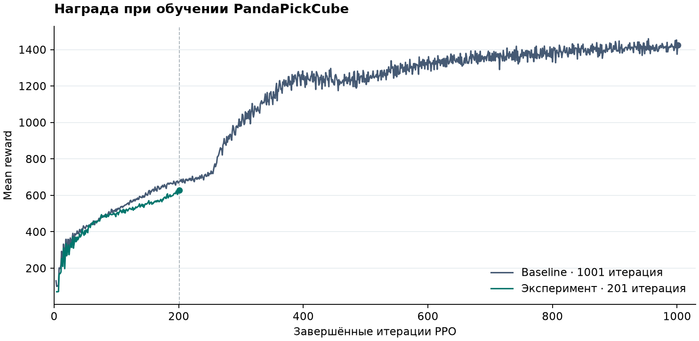

# Как число итераций влияет на обучение роборуки

Образцов Владислав Денисович · ВГУ · Робототехника, 2-я аттестация

В симуляторе `PandaPickCube` рука Panda должна поднять куб и перенести его к цели. Я обучил новую модель за 201 итерацию вместо 1001 и проверил обе модели в одинаковых условиях, по 10 попыток на каждую.

## Результаты

| Эксперимент | Изменение | Mean reward | SR | Время обучения | Поведение | Материалы |
|---|---|---:|---:|---:|---|---|
| **baseline** | `max_iters=1001` | 1425,81 | 10/10 | 53 мин 42 с | Поднимает куб и подводит его к цели. Средняя конечная ошибка 0,7 см. | [Логи и чекпоинт](experiments/baseline) · [Видео](videos/baseline.mp4) |
| **max_iters_201** | `max_iters=201` | 629,20 | 0/10 | 10 мин 18 с | Подводит захват к кубу, но ни разу не поднимает его выше 20 см. В конце попытки куб в среднем в 34,1 см от цели. | [Логи и чекпоинт](experiments/max_iters_201) · [Видео](videos/max_iters_201.mp4) |

Mean reward я взял из последней записи в журнале обучения. SR показывает, сколько попыток из 10 закончились успешно. Попытка засчитывается, если в конце куб оказался ближе 5 см к цели. Подъём выше 20 см считается захватом. [Сводная таблица CSV](experiments/summary.csv)

[Скачать архив проекта](https://github.com/xenorale/physicalai-ppo-experiment/archive/refs/heads/main.zip) · [Инструкция для проверки трёх чекпоинтов и дополнительные сценарии](verification/README.md)



## Вопрос и гипотеза

Успеет ли рука научиться переносить куб за 201 итерацию? Перед запуском я ожидал, что награда упадёт хотя бы на 10%, а успешных попыток станет как минимум на две меньше. За короткий прогон модель примерно в пять раз реже обновляется и проходит в пять раз меньше шагов в симуляторе. [Гипотеза до запуска](PREREGISTRATION.md)

## Настройки и команды

За baseline я взял модель из прогона `my_first_run`. Новую модель обучил с нуля 17.11.2026. В обоих прогонах было по 4096 сред, 40 шагов на среду за итерацию и seed 1. Награда считалась одинаково, настройки PPO тоже совпадали. Для проверки обеих моделей я использовал одни и те же seed, от 42 до 51. [Данные о запуске](experiments/run_manifest.json)

Скопируйте папку `experiments/` в корень учебного проекта и выполните там команды на GPU.

```bash
python3 train.py --exp_name max_iters_201 --num_envs 4096 --max_iters 201 --seed 1
python3 inference.py --checkpoint experiments/baseline/model_1000.pt --episodes 10 --seed 42 --record baseline.mp4
python3 inference.py --checkpoint experiments/max_iters_201/model_200.pt --episodes 10 --seed 42 --record max_iters_201.mp4
```

При запуске я ограничил расход видеопамяти с помощью скрипта. Код обучения и настройки среды можно взять из учебного проекта. [Скрипт ограничения памяти](bounded_python.py) · [Учебный проект](https://github.com/Yandex-Practicum/ap-physicalai-1/tree/70ea0fe0e039846126bd0f87f38738b710a0d515)

## Вывод

Гипотеза подтвердилась. Награда упала на **55,9%**, а число успешных попыток снизилось с **10 до 0**. Вместо 164 003 840 шагов в симуляторе модель прошла 32 931 840. Обучение заняло 10 минут 18 секунд вместо 53 минут 42 секунд.

После короткого обучения рука подводила захват к кубу и получала за это награду, но куб не поднимала выше порога. Первые 100 итераций на графике выглядят похоже. У baseline награда заметно выросла после 250-й итерации. Короткий прогон к этому моменту уже закончился. По этому запуску видно, что рука смогла подойти к кубу, а для подъёма и переноса ей, похоже, нужно больше времени. [Попытки baseline](experiments/baseline/episodes.csv) · [Попытки новой модели](experiments/max_iters_201/episodes.csv)

Я использовал один seed для обучения и проверил по 10 попыток на модель. Время замерялось в разных прогонах. На него могли повлиять загрузка компьютера и время подготовки симуляции.
